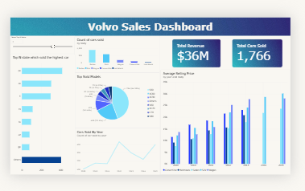

# Volvo Sales Dashboard (Power BI)

An interactive Power BI dashboard analysing Volvo used-car sales: revenue, units sold, top-performing states and models, and pricing trends by body type.



## Project Overview
This project explores Volvo sales data to answer key business questions:
- How much revenue and how many cars were sold in total?
- Which states sell the most cars?
- Which models and body types are most popular?
- How have sales volume and average selling price changed over the years?

## Dataset
- **Source:** Used car sales dataset (Kaggle), filtered to Volvo
- **Records:** 1,766 cars sold
- **Period:** 2009–2015
- **Key fields:** year, model, body, state, VIN, selling price

## Key Features
- **KPI cards:** Total Revenue ($36M) and Total Cars Sold (1,766)
- **Dynamic Top N slicer:** lets users choose how many states to display, built with DAX and a disconnected table
- **Sales by body type:** Sedan and SUV lead in volume
- **Top models:** S60 accounts for about 44% of sales, followed by XC60 (23%)
- **Cars sold by year:** trend of yearly sales volume
- **Average selling price by year and body:** price trends across body types

## Key Insights
- S60 is the best-selling model, making up nearly half of all sales.
- Sedans and SUVs dominate sales by body type.
- Pennsylvania (PA), California (CA) and Florida (FL) are the top three states by units sold.
- Average selling price generally rises for newer model years.

## DAX Used
```DAX
Total Cars Sold = COUNT(car_prices[vin])
Total Revenue = SUM(car_prices[sellingprice])
Dynamic Top N Cars = <your Top N measure>
```

## Tools & Skills
- Power BI Desktop
- DAX (measures, Top N logic, disconnected slicer)
- Data modelling and Power Query
- Data visualisation and dashboard design

## How to Use
1. Download `Volvo_dashboard.pbix`.
2. Open it in Power BI Desktop.
3. Use the Top N slider to change how many states are shown.

## Future Improvements
- Add profit and margin analysis (selling price vs market value)
- Add year and body-type slicers
- Add year-over-year growth indicators

